# How Assaycraft works

A guide to each part of Assaycraft, what it is for and how to use it. For the file formats and how to build or host the app, see the [README](../README.md).

- [What's new](#whats-new)
- [The idea](#the-idea)
- [Your first notebook](#your-first-notebook)
- [Entries: the notebook itself](#entries-the-notebook-itself)
- [Dynamic tables](#dynamic-tables)
- [The buffer and dilution calculator](#the-buffer-and-dilution-calculator)
- [Flows: a series of experiments](#flows-a-series-of-experiments)
- [Plate layouts](#plate-layouts)
- [Templates, sub-templates and variables](#templates-sub-templates-and-variables)
- [Protocols](#protocols)
- [Stocks](#stocks)
- [Literature](#literature)
- [Files, images and SnapGene maps](#files-images-and-snapgene-maps)
- [Notes](#notes)
- [Boards](#boards)
- [Calendar](#calendar)
- [Home and search](#home-and-search)
- [Version history](#version-history)
- [Trash](#trash)
- [Where the notebook is stored](#where-the-notebook-is-stored)
- [Your phone at the bench (Connect a phone)](#your-phone-at-the-bench-connect-a-phone)
- [Offline, installing and phones](#offline-installing-and-phones)
- [Settings](#settings)

## What's new

**28 October 2026**

- **Reminders.** Type `/reminder` in an entry, note or task: a checklist line with a date and time (“Take the plates out, Fri 2:30 PM”). Reminders show on the calendar, where you drag them to another day and tick them off, and in the private calendar link. [Reminders](#reminders).
- **Colours and sizes in text.** The toolbar’s _Colour and size_ button (the **A**) highlights in nine colours, colours text, and makes it small, large or huge. [Entries](#entries-the-notebook-itself).
- **Colour a tag.** Click a tag on an entry to choose its colour, for the whole notebook.
- **Tables:** right-click a cell for _Cell colour_, and _Freeze columns_ to keep the first columns in view while the table scrolls sideways. [Dynamic tables](#dynamic-tables).
- **Draw on images.** _Annotate_ on an image adds lines, arrows, boxes and text, to label a gel’s lanes or point at a band. The photo itself is not changed. **HEIC photos** from an iPhone are converted to JPEG when added. [Files and images](#files-images-and-snapgene-maps).
- **A reading board.** Papers have a reading status (_To read_, _Reading_, _Read_), and _Literature_ has a _Board_ view to drag them along. [Literature](#literature).
- **Calendar by project.** _By project_ colours everything on the calendar by its project, with a colour you can change for each. [Calendar](#calendar).
- **Flows:** _Set date_ on a step picks the day it is planned for on a small calendar; planned steps show on the calendar, and _Start_ uses that day. A started step’s entry sits under its plan in the sidebar. [Flows](#flows-a-series-of-experiments).
- **/day** inserts today, or another day you pick. Dates and day names are now always in English, whatever your computer’s language (the clock stays 12- or 24-hour as on your computer).
- **On a computer:** drag in the page’s margin to draw a box and select whole blocks (paragraphs, tables, images) to delete, copy or cut; hover the page’s right edge for its index (headings and days, and recent entries). <kbd>Tab</kbd> in a list now always nests the item.
- **Tidier pages.** The small blue labels above page titles are gone (except Home’s date), and so are Home’s counters of entries and tasks; Home only mentions tasks that are overdue.

**24 October 2026**

- **Times on experiments.** An entry's _Time_ (under its date) takes a start and an end time: pick one from the list or type it (“14:30”, “2pm”). _New entry_ asks for a start time too, next to the date, so a planned experiment is made in one go. The calendar shows it on the chip, in the week view and in the agenda, and Home lists the week with times. [Calendar](#calendar).
- **Other calendars in the calendar.** _Calendar → Calendars_ shows a calendar from Google, Apple or Outlook next to your experiments, read-only: the lab’s equipment bookings, seminars, your own calendar, with repeating events and time zones. [Calendar](#calendar).
- **Your experiments in your calendar app.** In the same window, _Create a private calendar link_ gives an address that Apple, Google or Outlook Calendar subscribe to, kept up to date while the notebook is open. It is off unless you turn it on. [Calendar](#calendar).

**23 October 2026**

- **Your phone at the bench, in sync.** _Connect a phone_ in the notebook menu shows a QR code; on the phone, choose **Connect to a computer** and scan it. The phone gets a copy of the notebook, and while Assaycraft is open on both, what you write on one shows up on the other within a second or two, empty lines included. The phone keeps its copy (it works offline at the bench), and the two catch up when they reconnect. Nothing is stored online. On a phone or tablet, the welcome page now offers just this; _No computer? Use this device on its own_ shows the other ways. [Your phone at the bench](#your-phone-at-the-bench-connect-a-phone).
- **Empty lines are kept.** An empty line left between paragraphs (Enter pressed twice) is saved, as `<br>` in the Markdown file, so it is still there when the page is opened again or on another device. Empty lines at the very end of a page are not saved.

- **Safari and Firefox.** _Open folder…_ on the welcome screen now works in Safari and Firefox: they can read a notebook folder but not save into it, so its notebook is copied into the browser; export a .zip to take your changes back. Images and other attachments in browser notebooks now save in every browser, including Safari's private windows, and Assaycraft asks the browser to keep browser notebooks rather than clear them to free space. [Where the notebook is stored](#where-the-notebook-is-stored).

**21 October 2026**

- **Go from one step of a flow to the next.** Inside a step, the flow bar now shows every step and offers _Next_, or _Start step 3_ when the next one has not been started, so you can work through a flow without going back to the plan. Flows also work with any entry ID prefix: with a prefix such as `EXP` or `LAB-26-`, steps used to lose their bar. [Flows](#flows-a-series-of-experiments).
- **TIFF images show in every browser.** Microscope frames, gel and blot images and scans saved as `.tif` now appear in the entry, not only in Safari; 16-bit and 32-bit images are contrast stretched for display, and stacks show one page at a time. The file stays exactly as your instrument saved it. [Files, images and SnapGene maps](#files-images-and-snapgene-maps).
- **Labcraft is now Assaycraft.** Notebooks made with Labcraft open as they are: the first time, `labcraft.json` becomes `assaycraft.json` and the `.labcraft` folder (version history and activity) becomes `.assaycraft`. Your appearance settings in the browser carry over too.

**19 October 2026**

- **Plate layouts** (type `/plate`): a 24-, 48-, 96- or 384-well plate map. Add your samples, standards and blanks, then click or drag across wells to place them; link a sample to a stock or an entry, and the stock lists the entry as using it. Copy the well list for Excel or a plate reader. [Plate layouts](#plate-layouts).
- **Trash**, at the bottom of the sidebar: everything you delete waits there. _Restore_ puts a page, board or folder back where it was, with its attachments; _Delete forever_ and _Empty trash_ remove it for good. [Trash](#trash).
- **Literature**, a library of the papers you read: add one by DOI or PubMed ID (or import BibTeX and RIS from Zotero, Mendeley or EndNote), keep reading notes on its page, and cite it from any entry or note with `/` → _Cite a paper_. Each paper lists where it is cited. [Literature](#literature).
- **The toolbar explains itself**: hover over a button to see its name, what it does and its keyboard shortcut.
- **Templates** start with a short how-to, with an example of how `{{double brackets}}` become questions and then text. [Templates](#templates-sub-templates-and-variables).
- **The tour** asks for your name (it signs your entries; you can still change it in Settings), and shows the flow and buffer calculator of a new **example entry**, which also cites a paper. [Your first notebook](#your-first-notebook).
- Searching in pickers matches each word you type, so “doudna 2012” finds the paper.

**Earlier in October 2026**

- **Flows** plan a series of experiments inside one entry, each step its own entry with its status and result on the plan. [How flows work](#flows-a-series-of-experiments).
- **Notes**, below Templates in the sidebar, for meeting notes, journal clubs and ideas: no ID, project or status. [Notes](#notes).
- **Buffer calculator**: amounts are shown as you pipette them (1 µL and 0.5 µL rather than “1000 nL” and “500 nL”), and `{{variables}}` in a buffer now work in templates: they used to be lost when the template was saved. [The calculator](#the-buffer-and-dilution-calculator).
- **Previews** of notes and entries (Notes list, Home) keep headings and list items apart: “Updates: Cloning done. Actions: Order Q5 · Book the reader”.
- **Templates** say “Reading the template…” while they work out the variables they ask for, instead of “No variables” for a moment; in a template, a flow shows the template each step starts from.
- **New notebooks** number entries `EXP-0001`, start a short **tour** (take it again from _Settings → About_) and include a Protein production template and a Lab meeting note.
- **Settings → Appearance** fits on laptop screens (the font choice used to be cut off).

## The idea

Assaycraft is an electronic lab notebook (ELN) that runs entirely in your browser. There is no account and no server holding your data: **every entry, protocol, template, board card and stock list is a Markdown file in a folder you choose**. You can open those files in any editor, back them up or put them in Git. If Assaycraft disappeared tomorrow, your notebook would still be readable.

The website only delivers the app. Once loaded, it works offline, and nothing you write is sent anywhere.

## Your first notebook

The welcome screen offers two ways to keep a notebook:

| Choice                        | Where the files live                                 | Best for                                            |
| ----------------------------- | ---------------------------------------------------- | --------------------------------------------------- |
| **A folder on this computer** | Any folder you pick                                  | One computer, your own backups                      |
| **Browser storage**           | Inside the browser (works in Firefox and Safari too) | Trying it out, or browsers that cannot open folders |

Saving into a folder needs a Chromium browser (Chrome, Edge, Brave, Arc). Safari and Firefox can open a notebook folder but not save into it, so they copy its notebook into browser storage. The first time you open a notebook you can fill it with examples: templates, sub-templates, protocols, stocks, a paper, a task board and an **example entry** (`Projects/Getting started/EXAMPLE-1`) that shows a flow, a buffer and a citation in use. Its ID is outside your numbering, so your first entry is still `EXP-0001`; delete it whenever you like.

**The tour.** A new notebook starts a short tour. It first asks for **your name**, which signs your entries as their author (the same setting as in _Settings → Notebook_). Then it points at each part of the app: the New entry button, the library (protocols, stocks and literature), templates, notes, boards and the calendar, then opens the example entry to show its **flow** and its **buffer calculator**, the `/` menu, search, **connecting your phone** and saving. Click _Next_ (or press →), _Back_ (←), or _Skip tour_ (Esc). It only starts once; take it again from _Settings → About_, the notebook menu or by searching “tour”.

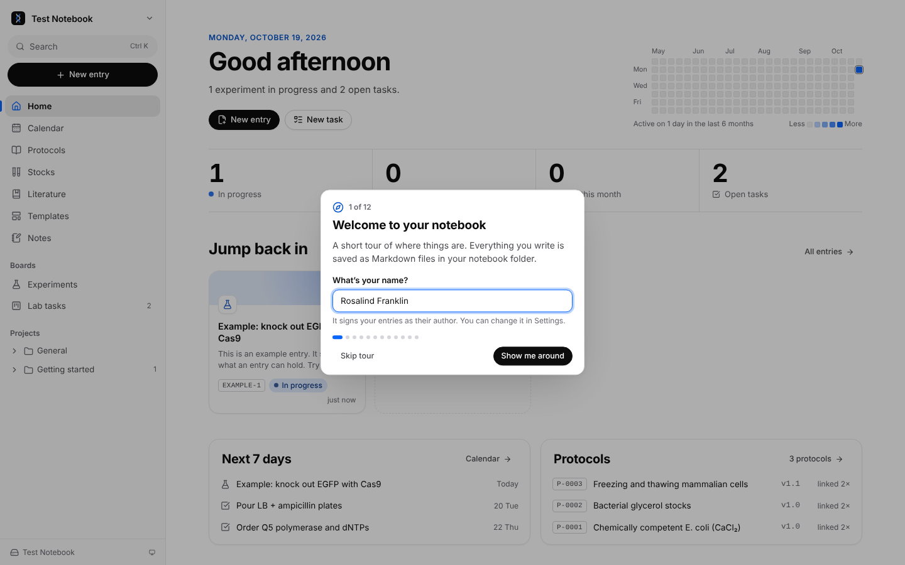

## Entries: the notebook itself

An **entry** is one experiment or one day's work. Click **New entry** (or press <kbd>Ctrl</kbd> <kbd>Alt</kbd> <kbd>N</kbd>), pick a template, give it a title, project, date and status, and fill in the template's blanks.

- **ID**: each entry gets the next number, `EXP-0001`, `EXP-0002`… IDs never change, even if you rename or move the entry, so you can cite them in a paper notebook or a figure legend. The prefix and number of digits are in _Settings → Notebook_.
- **Properties** at the top: status (_Planned_, _In progress_, _Completed_, _Failed_, or your own), experiment date or date range, project, tags, author and the protocols it follows.
- **Projects and folders** keep entries organised in the sidebar, and on disk (`Projects/CRISPR screen/…`).
- **Lock** an entry when it is finished and signed off: it becomes read-only (and is marked _Completed_) until you unlock it.
- **The editor** has headings, lists, checklists, quotes, code, sub- and superscript (H₂O, 10⁶), highlights and links, all in the toolbar above the page. **Hover over a toolbar button** to see its name, what it does and its shortcut.
- **Colour and size**: the **A** in the toolbar highlights the selected text in one of nine colours, colours the text itself, or makes it _Small_, _Large_ or _Huge_. The highlighter next to it is the quick yellow highlight (<kbd>Ctrl</kbd>+<kbd>Shift</kbd>+<kbd>H</kbd>). In the file these are small HTML tags (`<mark data-color="green">`, `<span class="gc-ink" data-color="red">`), with a style so other Markdown viewers show the colours too.
- **Tags** have a colour from their name; click a tag on an entry to choose another, for every page.
- **Type `/`** anywhere for blocks: _Table_, _Buffer_, _Flow_, _Stock_, _File or image_, _Sequence (SnapGene)_, _Protocol_, _Sub-template_, _Day_, _Reminder_, _Link to entry_, _Cite a paper_, _Plate layout_, _Checklist_ and more. The **+** button in the toolbar lists the same blocks.
- **/day** adds a heading for a day of work, “2026-10-28 · Wednesday”: today, or pick yesterday, tomorrow or any day.
- **Lists:** <kbd>Tab</kbd> nests the item you are in under the one above, <kbd>Shift</kbd>+<kbd>Tab</kbd> takes it out again, in bulleted, numbered and checklists.
- **On a computer**, drag in the page’s margin (left or right of the text) to draw a light-blue box: the blocks it touches are selected, to delete (<kbd>Delete</kbd>), copy or cut together. Hover the page’s **right edge** for its index: recent entries to jump to, then the page’s headings and days.

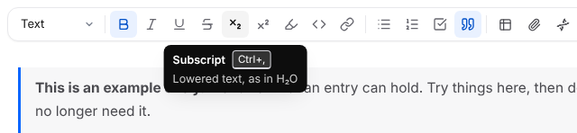

- **Links** between entries and protocols are ordinary Markdown links. Each page lists the pages that link to it.
- The **⋯** menu has _Duplicate_, _Save as template_ (or _sub-template_, or _protocol_), _Move to…_, _Version history_, _Download Markdown_, _Print / save as PDF_ and _Move to trash_ (bring it back from the [Trash](#trash)).

Saving is automatic: changes are written within about a second, and the sidebar footer says when.

## Dynamic tables

Type `/table` (or paste a table from Excel or Google Sheets) to get a spreadsheet inside the entry. It behaves like Excel:

- **Formulas** start with `=`: `=SUM(B2:B9)`, `=B2*$D$10`, `=ROUND(AVERAGE(C2:C4),2)`, `=IF(D2>0.5,"ok","low")`, `=COUNTIF(A2:A20,"pos")`. While typing a formula, click or drag over cells to insert their references. `$` keeps a reference fixed when copied. There are about 60 functions (statistics, rounding, logs, logic, text); the full list is in the [README](../README.md#tables).
- **Results update live**: change a volume and every cell that depends on it follows.
- **Fill**: <kbd>Ctrl</kbd>+<kbd>D</kbd> fills down, <kbd>Ctrl</kbd>+<kbd>R</kbd> right, or drag the square handle at the corner of the selection. A sequence such as `1, 2` continues as `3, 4…`; formulas shift as they are filled.
- **Copy and paste** with Excel and Google Sheets in both directions. Right-click for inserting, deleting and sorting rows and columns; drag the column edges to resize. Import or export CSV.
- **Cell colours:** right-click a cell (or a selection) → _Cell colour_. Colours move with their cells when rows and columns are added, deleted or sorted.
- **Freeze columns:** right-click a cell → _Freeze columns A–C_ keeps the columns up to it in view, with the row numbers, while a wide table scrolls sideways. _Unfreeze columns_ in the same menu, or in the table’s **⋯**.
- **Variables** from a template (`{{Reactions}}`) work in cells and formulas, so a master-mix table scales itself when the entry is created.

In the file, the table is a normal Markdown table showing the computed values, so it reads well anywhere; the formulas are kept in a comment just above it.

**Example: a master mix.** Put the volumes for one reaction in column D, the number of reactions in D10, and `=D2*$D$10` in E2. Fill E2 down: every row now shows the master-mix volume, and changing D10 updates them all.

## The buffer and dilution calculator

Type `/buffer` (or use the toolbar's **Insert** menu → _Buffer_) anywhere in an entry to plan whatever you make by mixing stocks: a buffer, a medium, a dilution or a reaction mix. You say what you have and what you want; Assaycraft tells you what to pipette, what to weigh and how much water to add.

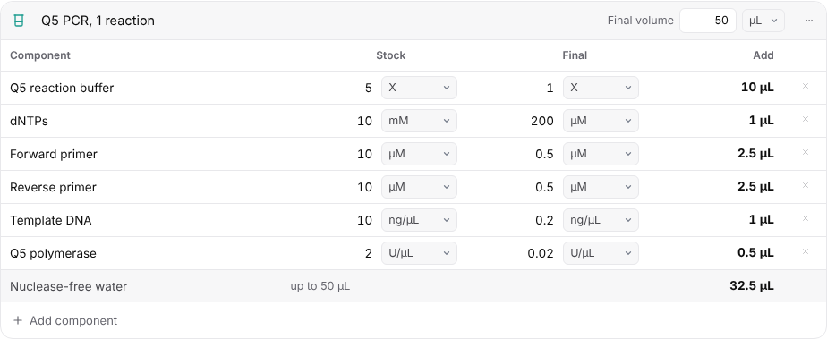

### Making one, step by step

1. **Name it** (optional), e.g. “Lysis buffer”, and set the **final volume** with its unit: L, mL or µL.
2. **Add the components.** For each one, type its name, the **stock** you have and the **final** concentration you want, each with its unit. <kbd>Enter</kbd> or <kbd>↓</kbd> moves to the next row, <kbd>↑</kbd> to the one above, and <kbd>Enter</kbd> on the last row adds a row. **Add component** at the bottom does the same.
3. **Read the Add column.** It shows how much of each stock to add, worked out as you type.
4. **Check the last row.** It says how much solvent brings the mix up to the final volume. It is called _Water_; rename it to what you fill up with (PBS, LB, nuclease-free water…), or empty it if nothing fills it up (e.g. a mix that is all stocks).

The **×** at the end of a row removes it. The **⋯** menu has _Add component_, _Copy as a table_ (to paste into Excel, Google Sheets or a table in Assaycraft) and _Delete buffer_.

### How it calculates

- **From a liquid stock**: C₁V₁ = C₂V₂, so the volume to add is _final volume × final concentration ÷ stock concentration_. Stock and final can be in different units of the same kind: 10 mM → 200 µM, 20 U/µL → 50 U/mL and 10 mg/mL → 100 µg/mL all work.
- **From a powder**: choose **g/mol** as the stock unit and type the molar mass where the stock goes. The Add column then says how much to **weigh**: _final concentration × final volume × molar mass_ (150 mM NaCl in 50 mL: 0.15 × 0.05 × 58.44 = 438.3 mg). When the final concentration is a mass per volume or a %, the mass follows from that alone (100 µg/mL in 500 mL is 50 mg), and the molar mass is not used.
- **The solvent** is the final volume minus every liquid you add. Powders do not count towards it.
- **Amounts are shown as you would pipette them**: in L, mL or µL down to 0.1 µL. Less than 0.1 µL is shown in nL, which is a sign to dilute the stock first. Masses are shown in g, mg or µg.
- Numbers can be typed `1.5`, `1,5` or `2e-3`.

### Units

| Kind            | Units                           | Notes                                                                    |
| --------------- | ------------------------------- | ------------------------------------------------------------------------ |
| Molar           | M, mM, µM, nM, pM               |                                                                          |
| Mass per volume | g/L, mg/mL, µg/mL, ng/µL, ng/mL | 1 mg/mL = 1 g/L, and 1 ng/µL = 1 µg/mL                                   |
| Percent         | %                               | Read as % w/v (1 % = 10 g/L), so it converts to and from mass per volume |
| Fold            | X                               | e.g. 10X PBS → 1X                                                        |
| Activity        | U/mL, U/µL                      | Enzymes                                                                  |
| Powder          | g/mol                           | Stock only: the molar mass of something you weigh                        |

Units of different kinds do not convert: from a 5 M stock you cannot make “1 %” without a molar mass. For a powder, use g/mol.

### Examples

Each of these was worked out by Assaycraft; the numbers are what you will see.

**50 mL of lysis buffer**, with a powder:

| Component       | Stock       | Final  | Add            |
| --------------- | ----------- | ------ | -------------- |
| Tris-HCl pH 8.0 | 1 M         | 50 mM  | 2.5 mL         |
| NaCl            | 58.44 g/mol | 150 mM | weigh 438.3 mg |
| EDTA            | 0.5 M       | 1 mM   | 100 µL         |
| Triton X-100    | 10 %        | 1 %    | 5 mL           |
| Water           |             |        | to 50 mL       |

Water: 42.4 mL (50 mL minus 2.5 mL, 100 µL and 5 mL; the NaCl is weighed).

**A 50 µL Q5 PCR**, with fold, molar, mass and enzyme units (the screenshot above):

| Component           | Stock    | Final     | Add     |
| ------------------- | -------- | --------- | ------- |
| Q5 reaction buffer  | 5 X      | 1 X       | 10 µL   |
| dNTPs               | 10 mM    | 200 µM    | 1 µL    |
| Forward primer      | 10 µM    | 0.5 µM    | 2.5 µL  |
| Reverse primer      | 10 µM    | 0.5 µM    | 2.5 µL  |
| Template DNA        | 10 ng/µL | 0.2 ng/µL | 1 µL    |
| Q5 polymerase       | 2 U/µL   | 0.02 U/µL | 0.5 µL  |
| Nuclease-free water |          |           | 32.5 µL |

For a **master mix**, set the final volume to the number of reactions times 50 µL, plus one spare: 450 µL for 8 reactions. Every amount scales.

**A simple dilution**: 500 mL of 1X PBS from 10X PBS is one row, 10 X → 1 X: 50 mL of 10X PBS and 450 mL of water.

**A medium with powders**: 500 mL of LB with ampicillin sodium salt (371.4 g/mol) at 100 µg/mL and glucose (180.16 g/mol) at 0.4 %: weigh 50 mg of ampicillin and 2 g of glucose, and fill with LB to 500 mL. Rename the solvent row to _LB_.

### When a row cannot work

Instead of a wrong number, the row (or, for the volume as a whole, a line under the buffer) says what is wrong:

| Message                                                     | What it means                                                                     |
| ----------------------------------------------------------- | --------------------------------------------------------------------------------- |
| The final concentration is above the stock                  | Diluting cannot concentrate: use a more concentrated stock                        |
| M and % don’t convert (or any two units)                    | The units measure different things: for a powder, use g/mol                       |
| A powder can’t be dosed in X                                | Fold (X) and activity (U/mL) need a liquid stock                                  |
| The components add up to more than the final volume         | The stocks are too dilute for this volume: use stronger stocks or a larger volume |
| Set the final volume to see the amounts                     | There is no final volume yet                                                      |
| The stock must be above 0, … is not a number, Choose a unit | Check what was typed                                                              |

### Faster ways in

- **Paste from Excel or Google Sheets**: copy rows of Component, Stock and Final, click a component cell and paste. Units can be in the same cell (`50 mM`) or in the next column (`50` | `mM`), and `uM`, `μM`, `mg/ml` and `x` are understood.
- **Copy as a table** (⋯ menu) to paste the recipe into Excel or into another entry.
- **In a template**, `{{variables}}` work in a buffer's name, components, stocks, final concentrations and final volume, e.g. a final volume of `{{Volume|50}}` mL. In the template the Add column shows “—”; a new entry from it asks for the values (an empty field takes the default) and calculates.
- In a **locked** entry, the buffer is read-only.

### In the file

A buffer is saved as an ordinary table, so the recipe reads anywhere. Its name, final volume and solvent are in a comment above it, and the amounts to add are written into the table:

```markdown
<!-- gc:buffer {"name":"Lysis buffer","volume":"50 mL","solvent":"Water"} -->

| Component       |       Stock |  Final |                Add |
| --------------- | ----------: | -----: | -----------------: |
| Tris-HCl pH 8.0 |         1 M |  50 mM |             2.5 mL |
| NaCl            | 58.44 g/mol | 150 mM |           438.3 mg |
| EDTA            |       0.5 M |   1 mM |             100 µL |
| Triton X-100    |        10 % |    1 % |               5 mL |
| Water           |             |        | to 50 mL (42.4 mL) |
```

If you edit that table in another app, Assaycraft reads it back and works the amounts out again.

## Flows: a series of experiments

Some work is a chain of experiments: transformation, starter culture, expression, extraction, purification. A **flow** plans that chain inside the entry that coordinates it, and links each step to the entry that carries it out. The plan shows, at a glance, where every step is and what came out of it.

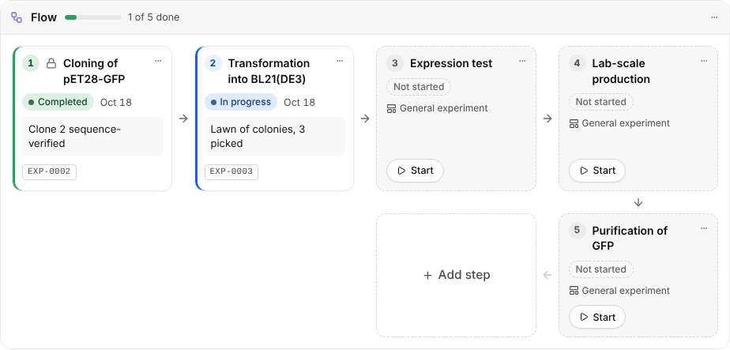

### When to use one

- **A flow** suits steps that happen in order, each an experiment of its own (with its own protocol, notes and data), when you want to see the whole chain: cloning → expression → purification; a mouse cohort from breeding to analysis; a screen from library to hits.
- **A task board** suits loose to-dos, and **headings and checklists** in one entry suit a single experiment with several parts.

### 1. Plan it

1. Make the coordinating entry, e.g. `EXP-0040 Production of GFP`, from any template, or start from the **Protein production** template, which already has a flow.
2. Type `/flow` where the plan goes. The new flow opens with its **Add step** field ready.
3. Type each step and press <kbd>Enter</kbd>; the field stays open for the next one. <kbd>Esc</kbd> closes it.
4. Optionally, give a step a **template** (its **⋯** menu → _Start from a template…_): its entry will start from it, e.g. _Molecular cloning_ for a cloning step. The card shows the template's name.

Steps are only names until they are started: a plan of ten steps does not use up ten `EXP-` numbers.

### 2. Start a step

Click the step's **Start**. The New entry window opens as **Start step 2**, already filled in:

- the **title** is the step's name, and the **template** is the step's template (or a blank entry);
- the **project** is the coordinating entry's project, the date is today and the status _In progress_; change any of them;
- if the template asks for `{{variables}}`, fill them in here.

Click **Start**: the entry is created and opens, and the step now links to it. If the experiment already exists as an entry, use the step's **⋯** menu → _Link an existing entry…_ instead.

### 3. Follow it

Each card shows the step's entry as it is now, so the flow is never out of date:

| The card looks…             | Meaning                                                    |
| --------------------------- | ---------------------------------------------------------- |
| Dashed, grey                | Not started yet. Shows its template and a **Start** button |
| Blue edge                   | Started: its entry has a status other than _Completed_     |
| Green edge                  | Completed                                                  |
| Red edge, “Entry not found” | Its entry was moved to the trash or deleted                |

On a card you also see the entry's **status**, its experiment **date**, a **lock** if it is signed off, its **ID**, and its **Result**. The flow's header counts the steps that are completed (“1 of 5 done”), and on the **Experiments** board the coordinating entry shows the same count (e.g. 1/5).

**The Result** is a one-line outcome you write in the step's entry (it has a _Result_ field once it is a step of a flow), e.g. “12 colonies, 3 picked” or “2.1 mg/mL, 94 % pure”. It shows on the card, so the plan reads as a summary of the whole project.

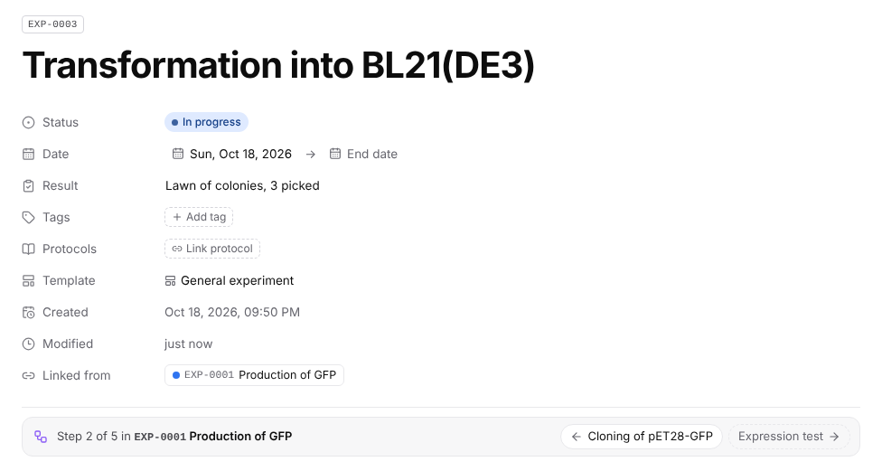

**Inside a step's entry**, a bar under the properties says _Step 2 of 5 in EXP-0040 Production of GFP_ and lists every step of the flow, with this one highlighted, the ones done ticked and the ones not started dashed. Click the coordinating entry to go back to the plan, or any started step to open it. When this step is done, the button under the steps takes you on: _Next: Expression test_ opens the next step, or, if it has not been started yet, _Start step 3: Expression test_ starts it right there, with its title and template, and adds it to the plan. Click a card's name to open its entry.

### 4. Change the plan

- **Rename** a step: click its name (steps not started yet).
- **Reorder**: ⋯ → _Move earlier_ / _Move later_. **Add** a step with **Add step** at the end; **remove** one with ⋯ → _Remove step_ (its entry, if it has one, stays in the notebook).
- **Unlink** a step's entry (⋯ → _Unlink entry_) to keep the step but not the entry.
- **Renaming or moving a step's entry** is fine: the card follows it by its ID, and the link in the plan's file is brought up to date the next time you open the plan.
- **Moving a step's entry to the trash** turns its card red (“Entry not found”); _Undo_ brings it back.
- **Locking the coordinating entry** makes the plan read-only: no Start, no menus, no Add step.

### Flows in templates

A template can hold a flow, so a project you run often starts with its plan. In a template, each step shows only its name and the template its entry will start from (or _Blank entry_): there is nothing to start in a template itself.

- `{{variables}}` work in step names: _Transformation into {{Strain|BL21(DE3)}}_ becomes _Transformation into BL21(DE3)_ in the new entry.
- An entry made from the template, a **duplicate** of an entry with a flow and a template **saved from** one all get the plan with no step started.

The starter **Protein production** template (new notebooks) plans: _Cloning of {{Construct}}_ (from Molecular cloning), _Transformation into {{Strain|BL21(DE3)}}_, _Expression test_, _Lab-scale production_ and _Purification of {{Protein}}_.

### Flows in notes, and on a phone

- A **note** can hold a flow too, e.g. to sketch a project before it starts. Started steps are saved in a project, and their bar points back to the note.
- On a **phone**, the steps stack in one column with arrows between them, and the step bar's buttons fill the width.

### Tips

- Keep **one flow per entry**: the step bar of a step's entry follows the first flow of the coordinating entry.
- A step counts as done when its entry is _Completed_. A failed step stays open on the plan: unlink it and start it again, or add a step for the repeat.
- Status, dates and results live only in each step's entry. Edit them there, and the plan follows.

### In the file

A flow is a numbered list of links under a comment, readable in any Markdown app. The comment keeps each step's template; started steps are links to their entries:

```markdown
<!-- gc:flow {"templates":{"1":"molecular-cloning","3":"general-experiment"}} -->

1. [EXP-0041 Cloning of pET28-GFP](EXP-0041%20Cloning%20of%20pET28-GFP.md)
2. [EXP-0042 Transformation into BL21(DE3)](EXP-0042%20Transformation%20into%20BL21%28DE3%29.md)
3. Expression test
```

A step's result is a `result:` line in its entry's front matter.

## Plate layouts

A **plate layout** records which sample went in which well: an ELISA, a qPCR run, a drug screen, a transfection. Type `/plate` (or **+** → _Plate layout_) in any entry, note or template.

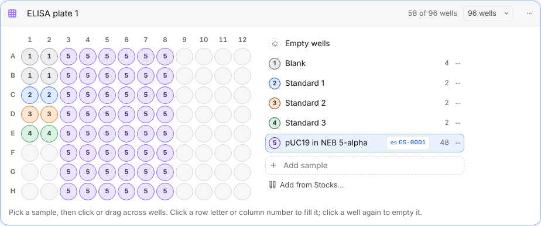

### Making one

1. **Name it** (_ELISA plate 1_) and pick the **format**: 6, 12, 24, 48, 96 or 384 wells. A plate can be made smaller later; Assaycraft asks first if filled wells would not fit.
2. **Add your samples** on the right: samples, standards, controls, blanks. Each gets a colour and a number. Blanks and no-template controls (_Blank_, _NTC_, _Mock_…) start grey.
3. **Pick a sample, then place it**: click a well, or **drag** from one well to another to fill the rectangle between them. Click a **row letter** or **column number** to fill the whole row or column. Click a well that already has that sample to empty it, or pick _Empty wells_ to clear several.
4. The count beside each sample, and _58 of 96 wells_ at the top, keep track as you go.
5. **Point at a sample** in the list to see its wells: the others fade back. Handy on a 384-well plate, where wells are too small to number. A sample's colour can be changed from its **⋯** menu.

With the keyboard: the arrow keys move between wells, <kbd>Space</kbd> or <kbd>Enter</kbd> puts the chosen sample in one, <kbd>Delete</kbd> empties it.

### Linking samples to stocks and entries

- **Add from Stocks…** adds a sample named after a stock (a glycerol stock, a cell line, an antibody…) and linked to it. Or link an existing sample from its **⋯** menu: _Link to a stock…_ or _Link to an entry…_ (for example the entry that made the sample).
- The link shows as a chip with the ID (`GS-0001`); click it to open the stock or entry.
- **The stock lists the entry as using it**, just like a stock linked in the text, so you can find every plate a stock went into.

### Getting it out

- **⋯ → Copy well list**: one line per well in plate-reader order (A1, A2 … H12) with the sample and what it is linked to, ready to paste into Excel or an instrument's plate setup.
- **⋯ → Copy plate map**: the plate as a grid, rows A–H and columns 1–12.
- In a **template**, sample names can hold `{{variables}}` (a sample called `{{Strain}}`): each new entry asks for them and fills in the wells too.
- In a **locked** entry the plate is read-only. Click (or tap) a sample to see where it is on the plate.

### In the file

A plate is a comment with its name, format and samples (colour and link), then an ordinary table with one cell per well, readable in any Markdown app or spreadsheet:

```markdown
<!-- gc:plate {"name":"ELISA plate 1","format":96,"samples":[{"name":"Blank","color":"gray"},{"name":"Standard 1","color":"blue"},{"name":"pUC19 in NEB 5-alpha","color":"purple","ref":"GS-0001"}]} -->

|     | 1          | 2          | 3                    | …   |
| --- | ---------- | ---------- | -------------------- | --- |
| A   | Blank      | Blank      | pUC19 in NEB 5-alpha | …   |
| B   | Blank      | Blank      | pUC19 in NEB 5-alpha | …   |
| C   | Standard 1 | Standard 1 | pUC19 in NEB 5-alpha | …   |
```

A plate table edited by hand is read back: new names in cells become samples.

## Templates, sub-templates and variables

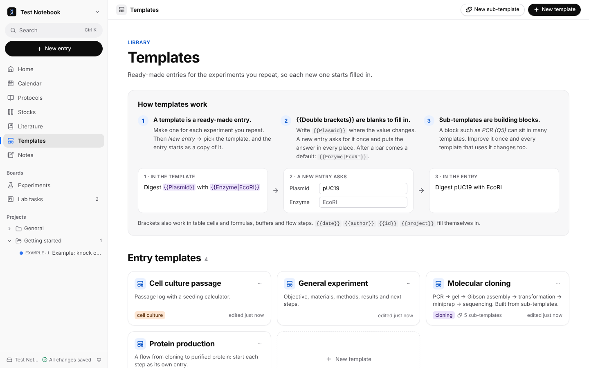

**A template is a ready-made entry** for an experiment you repeat. Click _New entry_, pick the template, and the new entry starts as a copy of it: same headings, tables, checklists and protocols. You only fill in what changes.

**`{{Double brackets}}` are the blanks.** Wherever a value changes from one run to the next, write a name between double curly brackets. When you create an entry from the template, Assaycraft asks for each one, once, and writes your answer everywhere it appears:

| 1. In the template                          | 2. The new entry asks                     | 3. In the entry         |
| ------------------------------------------- | ----------------------------------------- | ----------------------- |
| `Digest {{Plasmid}} with {{Enzyme\|EcoRI}}` | Plasmid: _pUC19_ · Enzyme: _(left empty)_ | Digest pUC19 with EcoRI |

- The name is your choice (`{{Plasmid}}`, `{{Cell line}}`, `{{Volume}}`). The same name in several places is asked once.
- After a bar comes a **default**: `{{Enzyme|EcoRI}}` gives _EcoRI_ when you leave the field empty.
- Brackets work in the text, table cells and formulas, buffers (`{{Volume|50}}` mL), flow steps and the entry title (`Cloning of {{Construct}}`, in the template's _Entry title_).
- Some fill themselves in: `{{date}}`, `{{time}}`, `{{weekday}}`, `{{id}}`, `{{title}}`, `{{author}}`, `{{project}}`.

**A sub-template is a building block** shared by templates: _PCR (Q5)_, _Agarose gel_, _Gibson assembly_, _Transformation_, _Miniprep_… Put one in a template with `/` → _Sub-template_. Templates keep a **reference** to it, so improving the PCR block once improves every template that uses it; choose _Copy_ on one to change it in that template only. In an entry, a sub-template is always copied in, so you can also drop a block into an entry you have already started.

**Making one**

- **New template** walks you through it: start from a suggested outline, a blank page or an existing entry. The template's _Check_ button finds missing sub-templates, unbalanced `{{` brackets and conflicting defaults.
- Any entry can be saved as a template, and any selection as a sub-template (**⋯** menu).
- A template can link protocols, so every entry made from it is linked too, and carry files (a plasmid map, a plate layout) that are copied into each new entry.

## Protocols

Protocols are your lab's reference methods (SOPs), kept apart from the day-to-day entries.

- Each has an ID (`P-0001`), a **version** and a status: _Draft_, _Active_ or _Retired_. **Release new version** asks what changed and adds it to the protocol's history. **Lock** an approved protocol to make it read-only.
- **Link** a protocol from an entry's _Protocols_ property, or in the text with `/protocol`, which can also insert a copy of the steps to tick off and annotate. **New entry with protocol** does both at once.
- A protocol lists **where it is used**: every entry, template and task that links to it. Clicking a linked protocol opens it in a side panel, so you can read it next to your entry.
- **Import a PDF** (a kit handbook, a vendor protocol, a colleague's SOP): it is converted in your browser, without uploading it, into an editable protocol with headings, numbered steps, lists, tables, figures and links. Headers, footers and contents pages are dropped, and two-column pages are read in order. The PDF is kept so you can **compare** the two side by side and fix what the conversion missed.

## Stocks

The **Stocks** page holds your physical collections, one table each: primers, plasmids, glycerol stocks, seeds, antibodies, cell lines, or your own kind.

- Each stock has an ID (`PR-0001`) and the columns you choose (name, sequence, location, box, date, notes…). Add, rename and remove columns; add rows one by one, paste them from Excel or import a CSV.
- **Primers** get their length, GC % and melting temperature (Tm) worked out from the sequence, using nearest-neighbour thermodynamics (SantaLucia 1998, 50 mM Na⁺, 250 nM primer).
- In an entry, type `/stock` to link one (`PR-0001 EGFP-fwd`). Clicking it opens the stock with its full details and **every entry that uses it**: useful when a primer stock turns out to be bad.
- Search (<kbd>Ctrl</kbd> <kbd>K</kbd>) finds single stocks by their ID, name or details.

## Literature

The **Literature** page is your library of papers: the ones you read, the methods you follow and the ones you will cite.

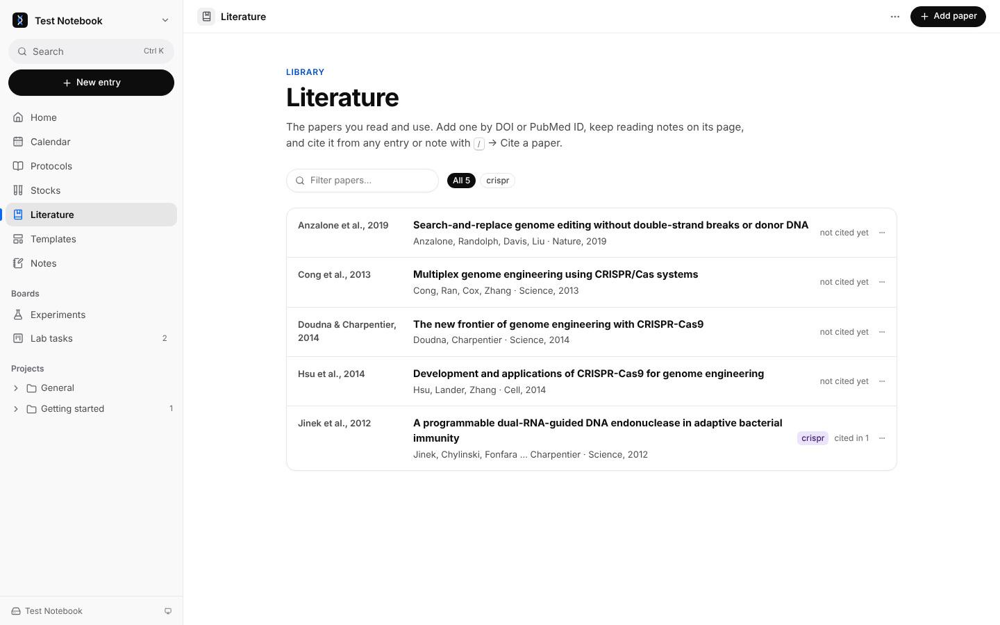

### Adding papers

- **By DOI or PubMed ID.** _Add paper_, paste a DOI (`10.1126/science.1225829`, or a doi.org link) or a PubMed ID (`22745249`, or a PubMed link) and click _Look up_: the title, authors, journal, year, volume, pages and abstract are filled in from Crossref or PubMed. Only the identifier you typed is sent; check the details and click _Add paper_.
- **By hand**, in the same form: for a thesis, a book chapter or when you are offline.
- **From a reference manager.** _⋯ → Import BibTeX or RIS_: paste or choose a `.bib` or `.ris` file exported from Zotero, Mendeley, EndNote or Google Scholar, or a journal's _Download citation_. Papers already in the library (same DOI, PubMed ID, or title and year) are skipped.
- A paper you already have is pointed out before you add it again.

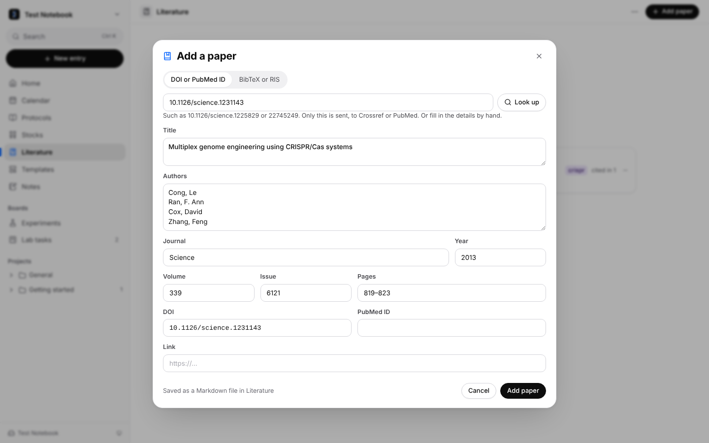

### Citing a paper

In any entry or note, type `/` → **Cite a paper** (or use **+** in the toolbar) and search by author, title, journal or year. It inserts a citation such as [Jinek et al., 2012](#literature), which is a link to the paper's page: click it to open the paper. If the paper is not in the library yet, choose _Add a paper_ in the same window; it is added and cited at once.

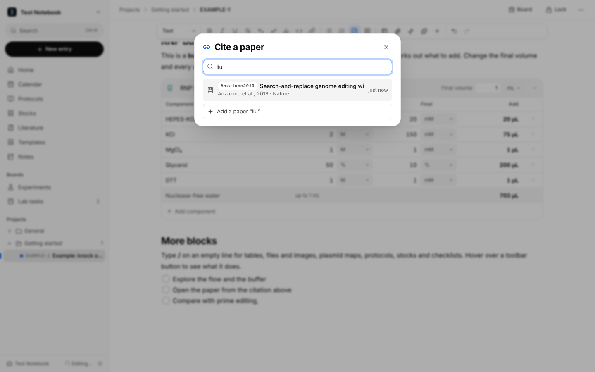

### Reading status and the board

Each paper has a **Reading** status: _To read_ (new papers), _Reading_ or _Read_. Change it on the paper’s page, from the list, or switch the Literature page to **Board** and drag papers from column to column. The list or board you chose is remembered.

### A paper's page

- The reference (authors, journal, volume, pages), links to the DOI and PubMed, tags, and **Cited in**: every entry and note that cites it.
- The page itself is for your **reading notes**: key findings, methods worth trying, figures to remember. A paper added with its abstract starts with it.
- _Copy citation_ (journal style), _Copy BibTeX_ and _Edit details_. _⋯ → Export all as BibTeX_ on the Literature page gives you a `.bib` file for your manuscript; after filtering, only the papers shown.

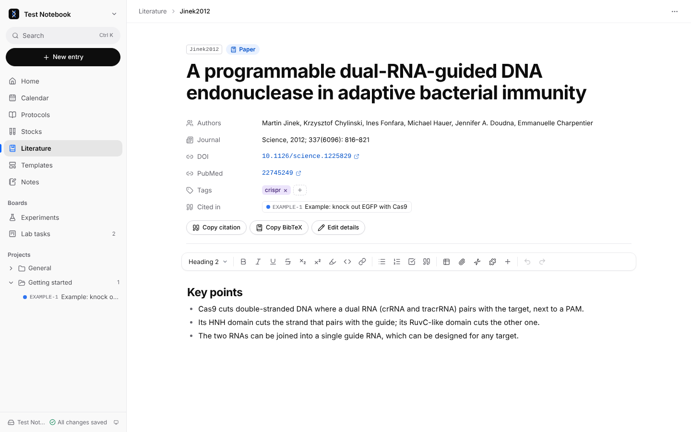

### In the file

Each paper is a Markdown file in `Literature/`, named after its citation key (`Jinek2012`, made from the first author and year, or the key from your BibTeX file):

```markdown
---
id: Jinek2012
kind: reference
title: A programmable dual-RNA-guided DNA endonuclease in adaptive bacterial immunity
tags: [crispr]
authors:
  - Jinek, Martin
  - Chylinski, Krzysztof
  - Doudna, Jennifer A.
year: 2012
journal: Science
volume: 337
issue: 6096
pages: 816–821
doi: 10.1126/science.1225829
pmid: 22745249
---

## Key points

- Cas9 cuts double-stranded DNA where a dual RNA pairs with the target, next to a PAM.
```

A citation in an entry is an ordinary Markdown link: `[Jinek et al., 2012](../../Literature/Jinek2012%20A%20programmable….md)`.

## Files, images and SnapGene maps

Drag and drop or paste anything into an entry. Files are stored next to it, in `attachments/<entry ID>/`.

- **Images** get a caption and a size. **PDFs** preview inline (also on phones). A **CSV** can be turned into a table.
- **TIFF images** (microscopes, gel imagers, scanners) are shown in any browser, with their size and bit depth under them. A 16- or 32-bit image is stretched from its darkest to its brightest values for display, as Fiji does when it opens one; the pixel values in the file are not changed. A stack or time series shows one page at a time, with arrows to step through. Images over 50 million pixels are not previewed; download them instead.
- **HEIC photos** (iPhones save these) are converted to JPEG when you add them, so every browser and Markdown viewer shows them. HEIC files already in a page are shown by converting them on the fly; the file stays as it is. (On the website; the single-file version cannot convert them.)
- **Draw on an image:** hover it and click _Annotate_. Pick _Line_, _Arrow_, _Box_ or _Text_ and a colour, and drag on the image (or click, for text). _Select_ picks a mark to delete or recolour; _Undo_ and _Done_ are there too. Text gets a halo so it reads on a dark gel and a light blot alike. The photo is not changed: the marks are saved in the page, in a comment just above the image, as positions relative to its size.
- **Formats a browser can't draw** show as a card with the file name and a _Download_ button, instead of a blank space.
- **SnapGene `.dna`, GenBank and FASTA** files show a plasmid map with SnapGene's feature colours, a feature table, GC % and the sequence. The original stays in the folder, ready to open in SnapGene.

## Notes

The **Notes** page (below Templates in the sidebar) is for meeting notes, journal clubs, brainstorming and ideas: anything that is not an experiment.

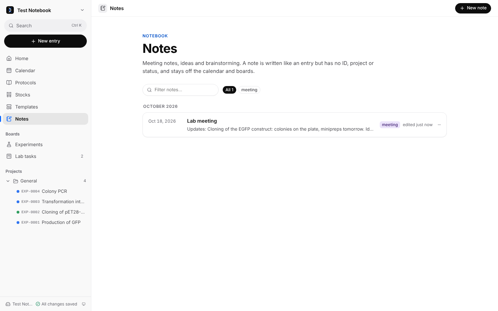

- **New note** opens a page with its title selected: type the title, press <kbd>Enter</kbd> and write. Everything an entry's editor does works here too (tables, checklists, images, `/` blocks).
- A note has a date and tags, and nothing else: no ID, project, status or protocols. It is not on the calendar or the boards.
- Notes are listed newest first, by month, with a filter and the tags to pick from. Search (<kbd>Ctrl</kbd> <kbd>K</kbd>) finds them, and they keep a version history like every page.
- Each note is a Markdown file in `Notes/`.

## Boards

Boards are Kanban columns, as in Notion or Trello.

- **Experiments** is built in: every entry by status. Drag a card to another column to change the entry's status.
- **Your own boards** come in two kinds, chosen when you create one (and switchable later from the board's **⋯** menu):
  - **Things to track** (the default): constructs, samples, orders, mice… moving through stages you name, e.g. _Designed → PCR → Assembled → Sequenced_. Cards have tags, links to entries and protocols, and full notes, but no due date, so they stay off the calendar.
  - **Tasks**: to-dos with a due date and a priority, e.g. _Lab tasks_. They show on the calendar and in Home's next 7 days, and Home warns when one is overdue.
- On a phone, boards scroll one column at a time.

## Calendar

- **Month**, **Week** and **Agenda** views. Entries appear on their experiment dates (including spans over several days) and tasks on their due dates.
- Drag an item to reschedule it, or click a day to plan an entry or a task on it.
- **By status or by project.** Entries are coloured by their status and tasks by their column. The _By project_ button (the palette, after Month · Week · Agenda) colours everything of a project alike instead, with each project listed above the calendar: click one to change its colour. Click _By project_ again to go back. Things outside projects stay gray.
- **Today** and the **‹ ›** arrows stay in the same place whatever the month's name, so you can click through months quickly.
- The week starts on **Monday or Sunday**, as set in _Settings → Appearance_. The activity graph on Home follows the same setting.

**Times.** An entry has a _Time_ under its date: a start time and, once that is set, an end time. Click _Add time_ and pick a time in the list (half hours) or type one: “9:30”, “14:30”, “2pm”. When you plan an experiment, _New entry_ has a _Time_ next to the date (leave it empty for none). The end time lists the times after the start with how long that is. On the calendar, the time comes before the title: short on a month’s chip (“9:30am”), on a line of its own in the week, as a range in the agenda. Items of a day are in order of time, those without one first. Drag an item to another day and it keeps its time.

**Other calendars here.** _Calendars_ (top right of the calendar) shows the events of other calendars next to your entries and tasks: the lab’s Google Calendar for the confocal and the FACS, the seminar series, your own calendar.

1. Copy the calendar’s iCal address. In **Google Calendar**, on a computer: Settings → under _Settings for my calendars_, the calendar → _Integrate calendar_ → _Secret address in iCal format_ (or the _Public address_ of a public calendar). In **Apple Calendar** (iCloud): the calendar’s share button → _Public Calendar_ → copy the link. In **Outlook**: Settings → Calendar → Shared calendars → _Publish a calendar_ → the ICS link.
2. In Assaycraft, _Calendar → Calendars_, paste it under _Calendar address_ and click _Add calendar_.

Its events show with a dashed outline in their own colour; click one for its time, place and notes. They are read-only here: change them in their own app. Repeating events, events moved or cancelled in a series, and other time zones all show as in the calendar’s app, at this device’s time. The list in _Calendars_ renames a calendar, changes its colour, hides it for now (_Show_) or removes it. The calendar is fetched again every ten minutes while the calendar is open. The address is saved in the notebook’s settings (`assaycraft.json`), so a connected phone shows the calendar too; a browser cannot read another site’s calendar directly, so Assaycraft’s website fetches it for the app and keeps nothing.

**Your experiments in your calendar app.** In _Calendars_, _Create a private calendar link_ gives an address to subscribe to in Apple, Google or Outlook Calendar (buttons for each), on your phone too. It holds the entries with a date (at their time, or all day) and the open tasks, with their ID, title, project and status; nothing else from the notebook. It is off unless you turn it on, because it is the one thing Assaycraft keeps online: a copy of those events at a long, random address on its website. Only the device that made the link can change it, and it brings it up to date a few seconds after the plan changes, while the notebook is open there. Calendar apps look for changes on their own: Apple Calendar as often as you set, Google Calendar every few hours. Keep the address private, as anyone with it can see these titles and times. _Turn off the link_ deletes the copy; calendars subscribed to it then show nothing.

### Reminders

Type `/reminder` in an entry, a note or a task and fill in what to remember, the day and (if you like) a time. It becomes a checklist line ending in a chip with the date: click the chip to change the day or time, or remove it. Typed at the end of a line that already has words, `/reminder` adds the date to that line.

On the calendar, reminders are rounded chips with a box: tick the box to mark it done (the checklist line in the page is ticked too), drag the chip to another day in the month or week to move it (its time stays), click its words to open the page. With the tasks hidden (_Tasks_ unticked), reminders are hidden too. Reminders still to do are in the private calendar link, at their time, so your phone’s calendar can remind you.

In the file, a reminder is plain text at the end of its line, `- [ ] Take the plates out (@2026-10-30 14:30)`: the same syntax as Obsidian’s Reminder plugin.

### Planned flow steps

A flow step not started yet can be planned for a day (_Set date_ on its card, or just the calendar icon beside _Start_ when the card is narrow). It shows on the calendar with a dotted outline under the entries; drag it to move it, click it to open the plan. Started, it becomes an entry with that day.

## Home and search

- **Home** shows the pages you edited last (_Jump back in_), the next 7 days (entries and tasks), any overdue tasks, and a GitHub-style **activity graph**: one square per day for the last 6 months, darker on the days you edited more.
- **Search** with <kbd>Ctrl</kbd> <kbd>K</kbd> (<kbd>⌘</kbd> <kbd>K</kbd> on a Mac) finds entries, protocols, templates, cards, papers (also by author) and single stocks by their title, ID or text, and runs commands such as _New task_, _Add a paper_, _Import PDF_ or _Take the tour_.

## Version history

Every entry, protocol, template, board card and stock collection keeps its earlier versions. Open them from the page's **⋯** menu → _Version history_.

**When a version is kept.** Not on every keystroke, but once per **editing session**: when you come back to a page after a break of 10 minutes or more (or after an hour of non-stop editing), the page as it was before is kept as a version. So each version is one sitting's work.

**What you see.** The versions grouped by day, each with the number of words added and removed. Pick one to see what changed in that session: edited lines word by word, and changed properties such as the title or status. Or switch to _Compare with current_ to see everything that differs from now. Long unchanged stretches are folded.

**Restoring.** _Restore this version_ brings the page back to it. The version it replaces is kept first, marked _Before restoring_, so a restore can itself be undone.

**How it stays small.** History is stored in the notebook, in `.assaycraft/history/`, one file per page, named by the page's ID so it follows renames and moves. The newest version is stored whole; each older one is stored only as the **change** needed to turn the next version back into it (“reverse deltas”). A page edited hundreds of times takes a few times its own size, not hundreds.

**Thinning.** Old versions are thinned out gradually, the way backup tools do it:

| Age                | Kept                      |
| ------------------ | ------------------------- |
| Last 24 hours      | Every version             |
| Up to a week       | The last one of each hour |
| Up to three months | The last one of each day  |
| Older              | The last one of each week |

The very first version and every _Before restoring_ version are always kept, up to 500 versions per page. The page's own Markdown file is always the current version, so other apps see nothing unusual. History goes into a .zip export; it is not brought in when importing a .zip into another notebook, where the same IDs may belong to other pages.

## Trash

Deleting a page, a board or a project folder never destroys it: it goes to the **Trash**, at the bottom of the sidebar (you can also drag a page from the sidebar onto it).

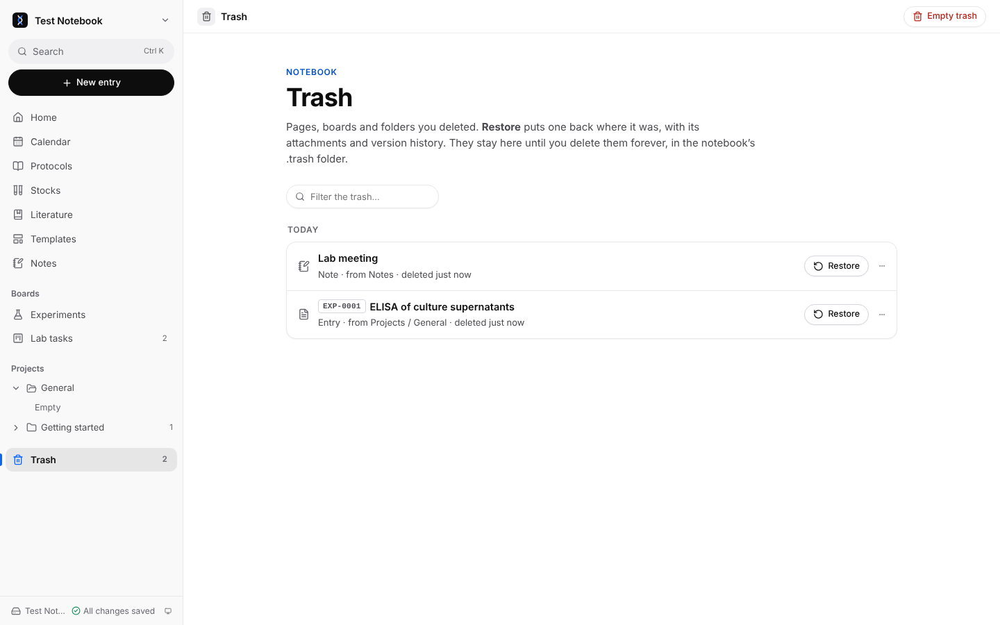

- Items are listed by the day they were deleted, with what they are and where they came from. Filter them by name or ID.
- **Restore** puts an item back where it was, with its attachments (and its version history, which never left). If something new has taken its name meanwhile, the restored page is saved beside it as “… 2”. A folder whose name is taken comes back as “… (restored)”.
- **Delete forever** (in an item's **⋯** menu) and **Empty trash** remove items for good, with their attachments and version history. Both ask first.
- A deleted page's **ID is never given to a new page**, so restoring it never makes two pages with the same ID.
- Right after deleting, the message at the bottom of the screen also has **Undo**.

On disk, the trash is the notebook's `.trash/` folder. `.trash/trash.json` remembers where each item came from; pages deleted before the Trash page existed go back to the usual folder for their kind (entries to _Projects_, protocols to _Protocols_…). The trash is not included in a .zip export.

## Where the notebook is stored

**A folder.** Assaycraft reads and writes the folder directly. The browser remembers it, and after a restart it may ask once to allow access again. If you change a file in another program, Assaycraft picks the change up when you come back to the window.

**Browser storage.** The notebook lives inside the browser's own storage. It works everywhere, but it is tied to that browser on that device: export a .zip regularly as a backup. Assaycraft asks the browser to keep it rather than clear it when space runs low (Firefox asks you once; Chrome and Safari decide on their own, and Safari may still clear a site you have not visited for weeks, so keep those backups).

**A folder in Safari or Firefox.** These browsers can read a folder but cannot save into it. _Open folder…_ copies the folder's notebook (Markdown files, attachments and settings; not `.git` or system files such as `.DS_Store`) into a new browser notebook named after it. Your changes stay in the browser: to bring them back to the folder, use _Export notebook (.zip)_ and unpack it there. To keep working directly in the folder, open it in Chrome, Edge, Brave or Arc.

**Notebooks made with Labcraft** (this app's earlier name) open as they are: the first time, `labcraft.json` is renamed `assaycraft.json` and the `.labcraft` folder `.assaycraft`. Nothing else in the notebook changes. An exported .zip from Labcraft can be opened or imported the same way.

**Export and import.** The notebook menu has _Export notebook (.zip)_ (everything, including attachments and history) and _Import .zip into notebook…_. Importing adds new files, skips identical ones and, when a file differs, adds the incoming one next to it as a copy (“… (2).md”), so nothing is overwritten.

## Your phone at the bench (Connect a phone)

The same notebook on your computer and your phone, without storing it online.

**Connecting a phone**

1. On the computer, open the notebook and choose **Connect a phone** in the notebook menu. It shows a QR code.
2. On the phone, open the site and choose **Connect to a computer** → _Scan the code_ (on a phone or tablet it is the only choice on the welcome page; _No computer? Use this device on its own_ shows the others). The phone's camera app works too: the code is a link that opens Assaycraft and connects. No camera? Use _Copy link_ on the computer and _Paste the link…_ on the phone.
3. The phone copies the notebook into its browser (entries, protocols, stocks, templates, boards and attachments) and opens it.

**Then**

- While Assaycraft is open on both devices, what you write on one appears on the other within a second or two, also in a page open on both.
- The phone keeps its copy and opens it without a connection. When both are open again they catch up: a page changed on one side is copied to the other, and a page deleted on one side is deleted on the other, unless it was changed there since.
- A page changed on both before they caught up is kept twice: the computer's version in its place, and the phone's next to it as “… (from iPhone).md”. Compare the two and delete the one you do not need. Nothing is overwritten without a trace: when a page is replaced by the other device's version, the version it replaces goes into its [version history](#version-history).
- The phone reconnects by itself whenever the notebook is open on both. The icon at the foot of the sidebar shows how it is going (green: in sync); click it for the details. On the phone the menu item is _Computer connection_, with _Try to connect now_ while the two are apart.
- Files over 50 MB, such as long microscopy stacks, stay on the device they were added on.
- The computer can connect several phones; each is listed on _Connect a phone_, with **Disconnect**. Disconnecting (from either device) stops the sync, and the phone keeps its copy as a notebook stored in its browser.

**Networks and privacy**

- The devices connect directly when their networks allow it (the same Wi-Fi, most home networks). When they do not, as with a phone on mobile data and a computer on an institute network, they go through Assaycraft's relay. Everything sent through the relay is end-to-end encrypted with a key that is only in the QR code and on your two devices: the relay passes along messages it cannot read, and stores nothing.
- The QR code is a key to the notebook: show it only to your own phone. It stops working when you leave the page, once a phone has used it.
- Connecting needs the website (not the single-file version).

## Offline, installing and phones

- After the first visit the app works **without a connection**: it keeps a copy of itself on the device (_Settings → About_ says so). When a new version is published, open copies download it and offer a **Reload**.
- **Install it as an app** from the browser's address bar (Chrome, Edge) or with _Add to Home Screen_ on a phone. It then opens in its own window.
- On phones and tablets the sidebar becomes a menu, dialogs fill the screen, boards swipe by column and the calendar opens as an agenda: handy for following a protocol at the bench.
- **Phones cannot open folders from a website.** To use a notebook on a phone, [connect the phone](#your-phone-at-the-bench-connect-a-phone) to the computer. Or carry a copy by hand: export a .zip on the computer and choose _Open a .zip…_ on the phone; notes made on the phone come back the same way, with _Import .zip into notebook…_.
- There is also a **single-file version** (`assaycraft.html`): the whole app in one file that runs offline from your disk, without any website.

## Settings

The notebook menu (top of the sidebar) → _Settings_:

- **Notebook**: its name, your name (the author of new entries; the tour asks for it too), and the ID prefixes and digits for entries (`EXP-`), tasks (`T-`) and protocols (`P-`). Changing a prefix only affects new items; existing IDs never change.
- **Entry statuses**: rename, recolour, add or remove the statuses of entries.
- **Appearance**: light or dark, the accent colour, sans or serif font, and the first day of the week (for the calendar and the activity graph). These are kept per browser.
- **Storage**: where this notebook lives and how its files are laid out.
- **Keyboard shortcuts**, and **About**: the version, whether the offline copy is ready, the tour, this guide and the source code.
